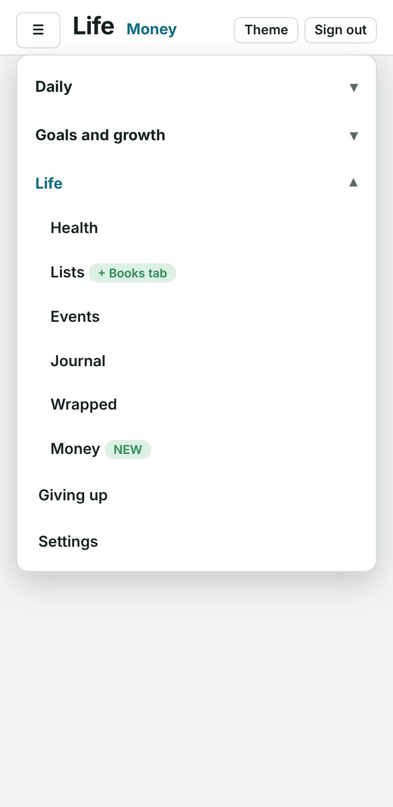
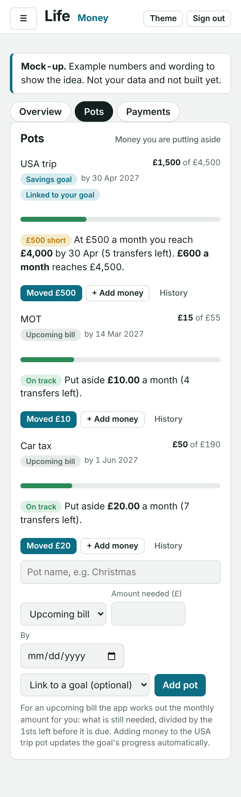
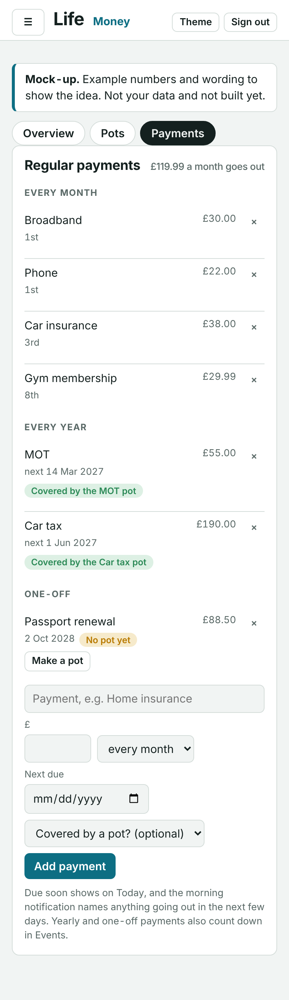

# Plan: a Books list and a Money section for the Life app

Built 27 Nov 2026. Written 27 Nov 2026, revised the same day (audiobooks added; Money reduced to payments, savings goals and bill pots, with no expense tracking). The screenshots are **mock-ups made from the app's real styles, with example numbers**, to show the idea. The one real figure is your USA trip saving goal.

## Short answers

- **Books to read or listen to:** a new **Books tab inside Lists** (next to Shopping, Packing and Wishlist). Not a new top-level menu item (the menu already has 13 sections) and not inside Playbook (that is a curated set of 24 books, not a personal queue). It links to your **goals** ("Read Born to Run", "Read The War of Art") and offers your **Playbook** books for one-tap adding, as a book or an audiobook.
- **Money:** one new menu item under Life with three tabs: **Overview, Pots, Payments**. It does **not** track what you spend. It tracks the things that are the same every month or year: regular payments, savings goals, and pots you fill for bills that are coming.

## 1. Books (read or listen)

**What it does**
- Every book is a **Book** or an **Audiobook** (chosen when you add it). The wording follows the format: **To read / Reading / Read** for a book, **To listen / Listening / Listened** for an audiobook. The list shows Reading and Listening as separate groups under "Now".
- Tap the stage to move a book on: up next, then now, then finished. Finishing asks for a **star rating** and sets the finished date.
- Optional **goal link** ("Goal: Read Born to Run, due 4 Dec"). Finishing a linked book ticks progress on that goal and offers "mark the goal achieved?". A listened audiobook counts the same as a read book.
- **From your Playbook:** the 24 Playbook books you have not added yet, each with "+ Book" and "+ Audio".
- Filters: Now, Up next, Finished, All.

**Data:** a new small table `life.books`: id, user_id, title, author, **format** (`book` or `audio`), status (`to_read`, `reading`, `read`, shown as listen / listening / listened for audiobooks), rating 1-5, goal_id, started_on, finished_on, playbook_key, note, sort_order, created_at. Own-row security like the other Life tables. The existing `list_items` table is not reused because it has no author, format, rating, goal or dates.

**Extras, optional:** a "Books finished" card in Wrapped (read and listened counted separately); "Currently reading / listening" on Today.

**Effort:** about an hour (one migration, one pure module with tests, the new tab, browser check).

## 2. Money

### Principles
- **No expense tracking.** It never asks you to log a coffee. It only holds numbers you set once and tick off: regular payments, pots, and a monthly transfer checklist.
- **GBP only.** Nothing reads your bank, so every figure is only as good as what you keep up to date, and the app says so.
- **Nudges, never blocks**, like the rest of the app.
- **Private by default:** the Money tables follow the Giving up rules (own-row only, never cached offline, backup only if you tick "Include Money", covered by the app lock's private scope). One deliberate exception is in the decisions below.

### Screens

**Overview:** this month's regular payments, what to move into pots, and (optionally) what is left of your income. Below that, the transfer checklist, what is going out soon, and where each pot stands.

**Pots:** two kinds. A **savings goal** pot (like the USA trip) and an **upcoming bill** pot (like the MOT or car tax). For a bill pot the app works out the monthly amount: what is still needed divided by the 1sts left before it is due. The **Moved £X** button is how you tell it you made the transfer in your banking app; it adds that amount to the pot.

**Payments:** your regular payments grouped as every month, every year and one-off, with the monthly total. A yearly or one-off payment can be **covered by a pot**, and the ones that are not covered are flagged with "Make a pot".

### How it ties into what you already have
- **Your savings goal.** "Save £500 per month for USA trip" (£1,500 of £4,500 by 30 Apr 2027) becomes a savings pot. Adding money to it updates the goal's progress automatically, the same way weigh-ins update a weight goal. It starts with a £1,500 opening deposit.
- **A finding about that goal.** Counting the transfers properly from 27 Nov, there are five left before 30 Apr (1 Dec, 1 Jan, 1 Feb, 1 Mar, 1 Apr). £500 each takes you from £1,500 to **£4,000, not £4,500**. £4,500 by 30 Apr needs **£600 a month**, or the 1 May payment. The Pots screen shows this ("£500 short") so it does not sneak up on you.
- **Renewals** (MOT, car tax, passport) count down in Events when they are yearly or one-off payments.
- **Reminders:** payments due in the next few days show on Today and in the morning notification, and Today nudges on pay day until the pot transfers are ticked off.

### Data (all `life` schema, own-row security)
| Table | Holds |
|---|---|
| `money_payments` | title, amount, cadence (weekly / monthly / yearly / one-off), next_due, optional pot_id (covered by), active |
| `money_pots` | name, kind (`saving` or `bill`), target amount, target_date, optional monthly_amount override, optional goal_id, sort_order |
| `money_deposits` | pot_id, amount (negative for taking money out), deposited_on, note. A pot's balance is the sum. |
| settings | optional monthly income and pay day (in the existing settings record, no new table) |

The monthly maths (transfers left, suggested amount, "short" or "on track", monthly total of regular payments, weekly and yearly converted to a monthly figure) lives in one pure module with unit tests.

### Build order
1. **Payments and Overview:** about 1 to 2 hours.
2. **Pots**, including the "Moved £X" transfers and the link to the USA trip goal: about 2 hours.
3. **Reminders:** morning notification line, Today nudge, Events countdown: about 1 hour.
4. **Later, only if wanted:** "Copy for Claude" monthly review, a net-worth line, a Wrapped money card.

Books first (small), then Money 1, 2, 3.

## Decisions for you

1. **Books:** Lists tab, its own table, Book or Audiobook on every title. OK?
2. **Money placement:** a normal item under Life (as drawn), or inside the **Private** group next to Giving up, behind the app lock? Recommendation: under Life, covered by the private lock scope.
3. **Payment reminders:** the morning notification can only name a payment if the notification function may read the payments table. Recommendation: allow it for **payments only** and keep pots and deposits unreadable by any function. Or no payment reminders.
4. **Monthly income:** type it once so the Overview can show "left after regular payments and pots"? Or leave the income out and show only the two outgoing totals?
5. **Pay day:** which day of the month do you move money (the drawings assume the 1st)?
6. **The USA goal:** keep £500 a month and accept £4,000 by 30 Apr, raise it to £600, or move the target date to 31 May?
