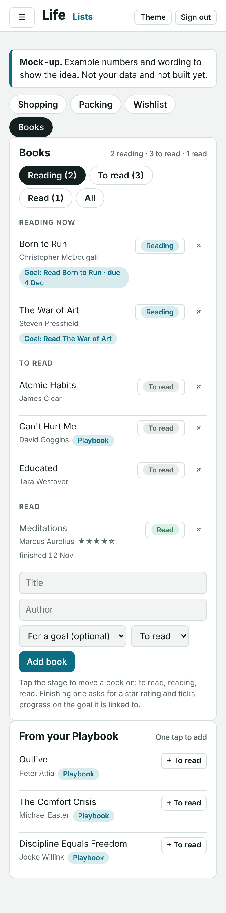
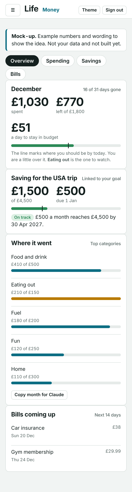
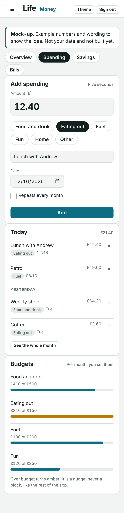
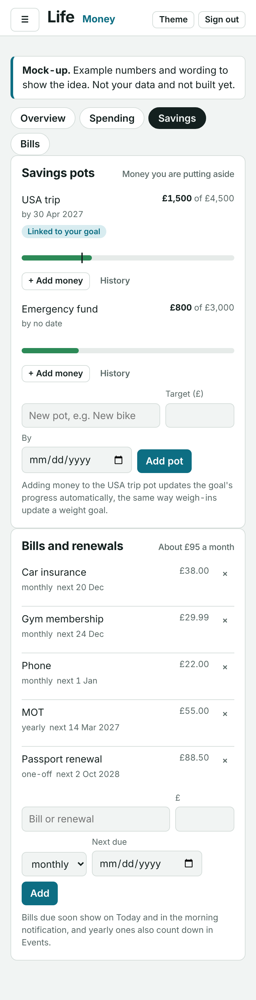

# Plan: a Books list and a Money section for the Life app

Written 27 Nov 2026. Nothing here is built yet. The screenshots are **mock-ups made from the app's real styles, with example numbers**, to show the idea (the one real figure is your USA trip saving goal).

## Short answers

- **Books to read:** a new **Books tab inside Lists** (next to Shopping, Packing and Wishlist). Not a new top-level menu item (the menu already has 13 sections) and not inside Playbook (that is a curated set of 24 books with directives, not a personal reading queue). It links to your **goals** (you already have "Read Born to Run" and "Read The War of Art") and offers your **Playbook** books for one-tap adding.
- **Finance:** one new menu item, **Money**, under Life, with four tabs: Overview, Spending, Savings, Bills. Handled as private data (like Giving up).

## 1. Books

**What it does**
- Three stages, tapped to move on: **To read → Reading → Read** (the same tap-the-stage pattern the Wishlist uses).
- Each book: title, author, optional **goal link** ("Goal: Read Born to Run, due 4 Dec"), optional **star rating** and **finished date** when it moves to Read.
- Finishing a book that is linked to a goal ticks progress on that goal and offers "mark the goal achieved?".
- **From your Playbook:** the 24 Playbook books you have not added yet, each with a "+ To read" button.
- Filters: Reading, To read, Read, All.

**Data:** a new small table `life.books` (id, user_id, title, author, status `to_read|reading|read`, rating 1-5, goal_id, started_on, finished_on, playbook_key, note, sort_order, created_at). Own-row security like the other Life tables. The existing `list_items` table is not reused because it has no author, rating, goal or dates and a fixed list of list types.

**Extras, optional:** a "Books finished" card in Wrapped; "Currently reading" under Today's habits.

**Effort:** about an hour (one migration, one pure module with tests, the new tab, browser check).

## 2. Money

### Principles
- **GBP only**, entered by hand first (fast capture matters more than perfect data). No bank connection: it needs a paid aggregator service, widens what is exposed, and is the part most likely to break. A **CSV import** of a bank export can come later.
- **Nudges, never blocks**, like the rest of the app: over budget turns amber, nothing stops you.
- **Private by default:** the Money tables follow the Giving up rules (own-row only, never cached offline, backup only if you tick "Include Money", covered by the app lock's private scope). One deliberate exception is discussed under decisions below.

### Screens

**Overview** (where you stand this month, the USA trip fund, where it went, bills coming up)

**Spending** (add in five seconds: amount, category chip, optional note, optional "repeats monthly"; today and yesterday; budgets per category)

**Savings and bills** (pots for things you are putting money aside for, bills and renewals with next due dates)

### How it ties into what you already have
- **Your savings goal.** "Save £500 per month for USA trip" (£1,500 of £4,500 by 30 Apr 2027) becomes a **pot**. Adding money to the pot updates the goal's progress automatically, the same way weigh-ins update a weight goal. The pot starts with a £1,500 opening deposit so nothing is lost.
- **Renewals** (car insurance, MOT, passport) already count down in Events; bills with a yearly or one-off cadence would show there too.
- **"Copy month for Claude"** (like the weekly check-in): one tap copies the month's totals by category, budgets, savings progress and bills as text, to paste into your Claude fitness-style project for a monthly money review.

### Data (all `life` schema, own-row security)
| Table | Holds |
|---|---|
| `money_entries` | entry_date, amount (> 0), category, note |
| `money_budgets` | category, monthly_amount |
| `money_pots` | name, target, target_date, optional goal_id, sort_order |
| `money_deposits` | pot_id, amount (negative for a withdrawal), deposited_on, note. A pot's balance is the sum. |
| `money_bills` | title, amount, cadence (monthly / yearly / one-off), next_due, active |

Default categories: Food and drink, Eating out, Fuel, Fun, Home, Other (editable).

### Build order
1. **Spending, budgets and Overview**: the core. About 2 to 3 hours with tests and browser checks.
2. **Savings pots**, including the link to the USA trip goal. About 1 hour.
3. **Bills**, with Today nudges, Events countdown for yearly ones and the morning notification line. About 1 hour.
4. **Later, only if wanted:** monthly "Copy for Claude", CSV import, a net-worth line, a Wrapped money card, and USA trip fund against the trip planner's costs.

Books first (it is small), then Money 1, 2, 3.

## Decisions for you

1. **Books:** Lists tab with its own table, as above. OK?
2. **Money placement:** a normal item under Life (as drawn), or inside the **Private** group next to Giving up, behind the app lock? Recommendation: under Life, but covered by the private lock scope.
3. **Bill reminders:** the morning notification can only name a bill if the notification function may read the bills table. Recommendation: allow it for **bills only**, and keep spending, budgets and savings unreadable by any function. Or no bill notifications at all.
4. **Budgets:** per category (as drawn) or one monthly total?
5. **Income:** track it, or only spending and savings (the budget is simply your monthly spending allowance)? Recommendation: spending and savings only.
6. **Categories:** keep the six defaults or change them?
7. **Bank connection:** confirm manual entry first with CSV import later.
